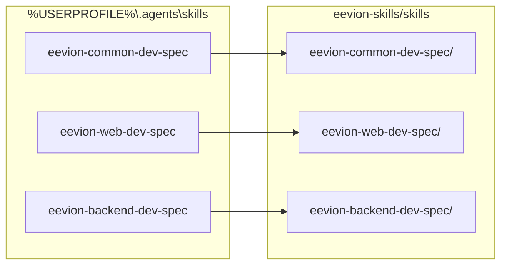

# eevion-skills

通用、前端和后端开发规范。可在对话中输入 `$eevion-web-dev-spec`，也可在项目的 `AGENTS.md` 中引用技能。

## Windows 

```sh
git clone https://github.com/eew0824/eevion-skills.git
```

双击本地仓库的 `scripts\install.cmd` 查看预览。输入 `y` 并回车安装，直接回车取消。安装成功后会自动打开技能目录。

## 安装到哪里

左侧是当前用户的全局技能链接（Junction），右侧是它们指向的本地仓库目录。



保留本地仓库的位置。已有技能随本地修改或 `git pull --ff-only` 更新。新增技能后再运行安装脚本。

## macOS / Linux

在本地仓库根目录运行以下命令。

```sh
mkdir -p ~/.agents/skills
for dir in "$PWD"/skills/*; do
  [ -f "$dir/SKILL.md" ] && ln -s "$dir" ~/.agents/skills/
done
```
