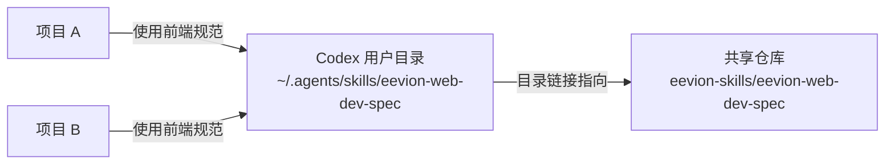

# eevion-skills

## 1. 创建仓库

创建一个 Git 仓库并克隆到本地。把共享 skill 放在仓库根目录，每个 skill 一个文件夹，例如 `eevion-web-dev-spec/SKILL.md`。

## 2. 接入 Codex

在共享仓库根目录运行下方命令，为前端规范建立图中的链接。接入其他 skill 时，换成对应名称即可。



编辑共享仓库里的 `SKILL.md`，两个项目都会读到更新。

**Windows（PowerShell）**

```powershell
$skill = 'eevion-web-dev-spec'
$dir = "$env:USERPROFILE/.agents/skills"
New-Item -ItemType Directory -Force -Path $dir | Out-Null
New-Item -ItemType Junction -Path "$dir/$skill" -Target (Resolve-Path $skill).Path
```

**macOS / Linux**

```sh
skill=eevion-web-dev-spec
mkdir -p ~/.agents/skills
ln -s "$PWD/$skill" ~/.agents/skills/
```

## 3. 日常使用

- **单次对话**：输入 `$` 或者 `/` 选择 skill，再写需求。例如 `$eevion-web-dev-spec 帮我检查这个页面的移动端布局。`
- **项目约定**：在 `AGENTS.md` 里按名称引用 skill。
- **跨电脑同步**：推送后，在另一台电脑的共享仓库运行 `git pull --ff-only`。首次接入或新增 skill 时，再做一次第 2 步。
